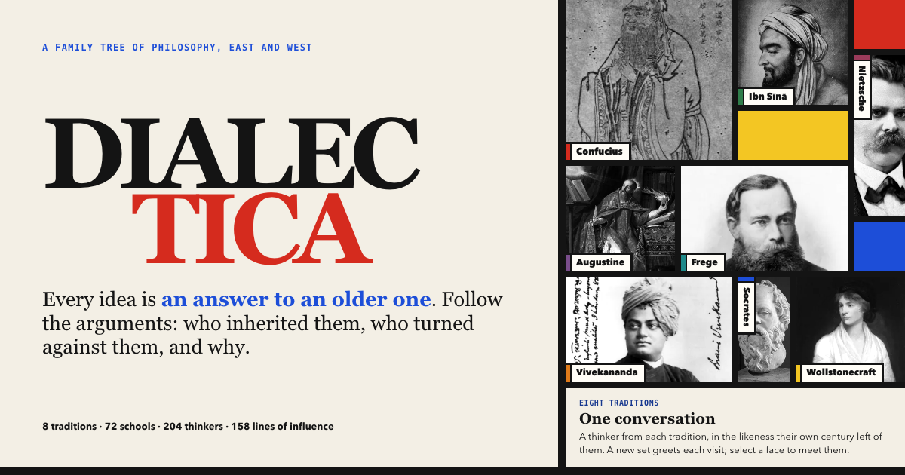

# Dialectica · 思辨谱

A bilingual (English / 中文) atlas of philosophy in the style of Mondrian. It draws the family tree of 72 schools and the network of 204 thinkers across eight traditions, from the Upanishads and the Hundred Schools to analytic philosophy, and shows where each idea came from, the reasoning behind it, who taught, read and argued with whom, and where traditions met.



**Live site:** https://dialectica.geekplux.com/ ([中文](https://dialectica.geekplux.com/?lang=zh))

Colour always means tradition. Where its sibling [Worldlines](https://worldlines.geekplux.com/) is all grids, Dialectica puts people in the grid and follows the lines between them.

- **Eight faces.** The hero is a Mondrian grid of portraits, one thinker from each tradition in the likeness their own century left of them, in black and white until you hover. A new eight is dealt on each visit.
- **Lineage.** Every school is a block on a shared time axis, one lane per tradition, drawn for as long as it lasted. Lines join schools: solid when an idea is carried forward, dashed red when one school argues against another, dotted blue when an idea crosses between traditions. Select a school to light up its direct links or its whole lineage, and filter by branch (metaphysics, knowledge, ethics, politics, logic and language, mind, God and the ultimate). Hover a line to read what passed along it.
- **Thinkers.** Each thinker is a square placed at about the age of forty. Ties join teachers to students, readers to the writers who shaped them, and critics to their targets; each kind can be switched off.
- **Crossings.** A matrix, after Bertin: rows give, columns receive, and each square counts the school links and thinker ties that crossed from one tradition into another. Select a square to read every crossing behind it.
- **Questions.** Seven big questions (what is real, how we know, how to live, what makes power legitimate, what the self is, whether words reach the truth, whether there is a ground of everything), each answered by a dozen schools in time order, with a small map of where each answer sits.
- **Schools.** An index of every school by tradition, each with a sparkline of its lifetime on the shared time axis.
- **Panels.** A school's page gives its question, why it arose, the reasoning behind it, three key claims, what it left, its thinkers and key texts, where it came from and what it led to, and its answers to the big questions. A thinker's page gives their idea, works and schools, their circle (teachers, influences, students, those they shaped and their critics, drawn as one small Mondrian composition), and contemporaries in other traditions. A thinker's panel also has a fuller two-paragraph introduction (life and setting, then the thought explained), and both kinds of panel show the fact checks that concern them.
- **Search** (<kbd>/</kbd>) covers schools, thinkers and works in both languages. <kbd>Esc</kbd> closes panels.
- **Shareable links.** English is the default; `?lang=zh` opens the Chinese view. The hash records the open school or thinker, the question and the crossing, e.g. `/?lang=zh#s=madhyamaka` or `/#t=kant&q=know&x=greek.islamic`.
- **A page for everything.** Every school and thinker also has a static page in each language (`/schools/stoicism/`, `/zh/thinkers/kant/`), with its own title, description, canonical and hreflang links, Open Graph card and JSON-LD, plus hub pages for all schools and all thinkers. They are written by `scripts/build-pages.mjs` from the data, so search engines and readers without JavaScript see the whole atlas.
- **Fact-check.** The first draft's doubts were checked against published scholarship; every verdict, finding and source is published at [/fact-check/](https://dialectica.geekplux.com/fact-check/) and beside the entry it concerns.
- **No build step.** Plain HTML, CSS and JavaScript, with the content in five data files; the static pages are generated by a dev-time script and committed. A sibling of [Art-isms](https://artisms.geekplux.com/) and [Worldlines](https://worldlines.geekplux.com/).

## Sister atlases

Three bilingual atlases on one Mondrian grid, built the same way: static files with no build step, content in `{ en, zh }` data files, Cloudflare Workers, Google Analytics behind a consent bar. Each site's footer opens with a strip that links to the other two.

| | Atlas | What it maps |
| --- | --- | --- |
|  | [Art-isms · 艺术流派志](https://artisms.geekplux.com/) · [code](https://github.com/geekplux/artisms) | 40 art styles across 45,000 years, how each grew from the last, and three real works for each |
|  | [Worldlines · 世界线](https://worldlines.geekplux.com/) · [code](https://github.com/geekplux/worldlines) | 26 countries and 8 regions across 15,000 years, chapter by chapter or one year at a time |
|  | [Dialectica · 思辨谱](https://dialectica.geekplux.com/) · [code](https://github.com/geekplux/dialectica) | 72 schools and 204 thinkers across 8 traditions: who taught, read and argued with whom |

Made by [GeekPlux](https://geekplux.com/). I built these atlases out of my own curiosity, mainly to learn from them myself.

## Run it locally

```sh
python3 -m http.server 8000 --directory public
# then visit http://localhost:8000
```

`npx wrangler dev` also works. Portraits with a free licence are hosted in `public/images/portraits/`; the rest load from Wikipedia, so they need a connection, and without one each panel shows a Mondrian plate instead.

## Project structure

```
public/                 everything that is deployed, and nothing else
  index.html            the atlas: page skeleton, static copy, SEO tags, analytics setup
  assets/styles.css     all styles (paper, ink and De Stijl)
  assets/app.js         the hero, both maps, crossings, questions, panels, search, i18n, routing, consent bar
  assets/page.js        consent bar and page view for the static pages
  data/core.js          traditions, branches, eras of the time axis, the big questions, learning notes
  data/schools.js       every school
  data/thinkers.js      every thinker (with `portrait` written by fetch-portraits)
  data/links.js         links between schools and ties between thinkers
  data/facts.js         the fact checks: verdict, finding and sources
  images/portraits/     hosted portraits (WebP, 600 and 300px)
  schools/, thinkers/, fact-check/, credits/, zh/    generated static pages (do not edit)
  sitemap.xml           generated
  _headers, robots.txt, og.png, favicon.svg, favicon-48.png, apple-touch-icon.png
scripts/check-data.mjs      validates the data, portraits, credits, asset stamps, counts and generated pages
scripts/build-pages.mjs     writes the static pages, the sitemap and the static index in index.html
scripts/fetch-portraits.mjs downloads portraits from Commons and regenerates CREDITS.md
scripts/stamp-assets.mjs    writes ?v=<content hash> into index.html
scripts/lib/                shared helpers (data loading and saving, credits)
docs/                       fact-check record and open questions
CREDITS.md                  image credits (generated)
wrangler.jsonc              Cloudflare Workers Static Assets config
```

## Content model

Every piece of text is a `{ "en": "…", "zh": "…" }` pair. Years are integers; negative years are BCE and there is no year 0.

A **school** (`public/data/schools.js`):

```js
{
  "id": "stoicism", "tradition": "greek", "start": -300, "end": 250,     // end 2026 for a living tradition
  "dates": { … },                                                       // display text, e.g. "c. 300 BCE – 3rd c. CE"
  "name": { … }, "branches": ["ethics", "logic", "metaphysics"],
  "idea": { … },        // the core thesis in one sentence
  "question": { … },    // the question it set out to answer
  "origin": { … },      // why it arose
  "reasoning": { … },   // the argument behind it
  "claims": [ {…}, {…}, {…} ],
  "legacy": { … },
  "works": [ { "by": "epictetus", "t": { … }, "y": 108 } ],
  "figures": ["zeno-citium", "chrysippus", "seneca", "epictetus", "marcus-aurelius"],
  "tags": "stoa logos virtue 斯多葛 …",
  "wiki": "Stoicism"    // English Wikipedia title, for the image and "read more"
}
```

A **thinker** (`public/data/thinkers.js`):

```js
{ "id": "epictetus", "tradition": "greek", "born": 50, "died": 135,      // died: null for the living
  "life": { … }, "name": { … }, "role": { … }, "idea": { … },
  "schools": ["stoicism"], "works": [ { "t": { … }, "y": 125 } ], "wiki": "Epictetus" }
```

For ancient thinkers whose dates are unknown, `born`/`died` are conventional placeholders that put them in the right place on the map; `life` says what is actually known.

**Links** join schools and **ties** join thinkers (`public/data/links.js`). Both read `from → to`:

| `kind` | Between | Meaning |
| --- | --- | --- |
| `dev` | schools | `to` carries forward or develops `from` |
| `react` | schools | `to` reacts against `from` |
| `fuse` | schools | `to` borrows from `from` across traditions |
| `taught` | thinkers | `from` was `to`'s teacher |
| `infl` | thinkers | `from`'s work shaped `to` |
| `opp` | thinkers | `to` argued against `from` |

Links carry a one-sentence `note` on what passed between them; ties may.

## Adding or correcting content

1. Edit the data file. Scripts should go through `loadData()`/`saveData()` in `scripts/lib/data.mjs`, which keep the one-entry-per-line layout.
2. To add a portrait, set the thinker's `c` to a Wikimedia Commons file name (the artwork must be free; see CLAUDE.md), then run `node scripts/fetch-portraits.mjs`. Look at the image before committing.
3. If you changed `assets/app.js` or `assets/styles.css`, run `node scripts/stamp-assets.mjs`.
4. Run `node scripts/build-pages.mjs` to regenerate the static pages and sitemap.
5. Run `node scripts/check-data.mjs`; add `--warnings` to list thinkers without ties and schools without links.
6. Open the page in both languages, at desktop width and at 390px.

CI runs the same check on every push and pull request; it fails if a stamp, a portrait hash, CREDITS.md or a generated page is stale.

## Deployment

The site is served at **https://dialectica.geekplux.com/** by **Cloudflare Workers Static Assets** with Workers Builds (Git integration), like the sibling sites: every push to `master` runs `npx wrangler deploy`, which uploads `public/` as configured in `wrangler.jsonc`. The Worker name `dialectica` must match the Worker in the Cloudflare dashboard. The old `dialectica.geekplux.org` still serves the same Worker as a secondary domain; canonical tags, the sitemap and every link use `.com`.

`public/_headers` caches `assets/` and `images/` for a year. That is safe because every reference carries a content hash (`?v=…`) written by `scripts/stamp-assets.mjs`, `scripts/build-pages.mjs` and `scripts/fetch-portraits.mjs`; `check-data` fails while a hash is stale. HTML and `data/` are revalidated on every visit.

## Analytics

Google Analytics 4 (`G-1MGF28FKRC`) runs on **dialectica.geekplux.com** (and the secondary `.org`) **only**, never locally or on preview URLs, set up as in Worldlines. It uses Consent Mode v2: until a visitor accepts in the consent bar, `analytics_storage` is denied, so GA receives cookieless pings and sets no cookies. Accepted cookies are host-only (`cookie_domain: "none"`), so they are not shared with Art-isms, Worldlines or any other `*.geekplux.com` site, and declining deletes any `_ga` cookies. Page views are sent by `app.js` after the page has rendered, without the hash. In the GA4 property, keep **Admin → Data streams → Enhanced measurement → Page views → Show advanced settings → "Page changes based on browser history events"** turned off, or each `?lang` switch logs an extra page view. Search sends only the number of matches, never the typed text; leaving for a sister atlas sends `select_content` with `content_type: "sister"`.

## Caveats

Schools rarely begin or end in a single year, and many ancient dates are traditional or disputed. Every line is a simplification of conversations that ran for generations, and the selection is deliberately small: a map for learning, not a complete history of philosophy.

## License

- Code (`public/index.html`, `public/assets/`, `scripts/`): [MIT](LICENSE)
- Written content in `public/data/`: [CC BY-SA 4.0](https://creativecommons.org/licenses/by-sa/4.0/)
- Portraits in `public/images/portraits/` are resized from Wikimedia Commons files and keep their own licences (public domain or Creative Commons); see [CREDITS.md](CREDITS.md). Other images are loaded from Wikipedia at view time.
